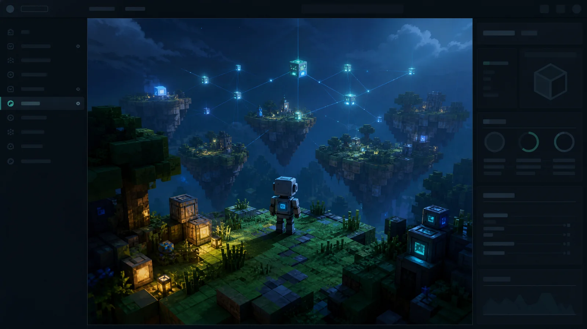

# Minecraft Workers Bot



运行在 Cloudflare Workers 和 Durable Objects 上的 Minecraft Java 1.8.9 离线机器人，提供中文管理控制台、服务器配置、状态监控、聊天和简化第一人称画面。

> 上图是 AI 生成的项目主题插画，不是控制台截图。实际画面使用轻量 Canvas 体素渲染。

[控制台](https://minecraft-connectivity-probe.ooyyh.workers.dev/) · [API 文档](https://minecraft-connectivity-probe.ooyyh.workers.dev/docs)

## 功能

- 在页面配置服务器域名/IP 和端口，测试连接并保存；运行中的机器人在切换地址后重连。
- Durable Object 持久化服务器配置和运行状态，处理 KeepAlive、断线重连和死亡复活。
- 显示连接状态、游戏坐标、数据包计数及最近聊天/事件。
- 提供附近区块的简化第一人称画面、鼠标锁定、全屏和 WASD 控制。
- 支持发送聊天及 `/` 开头的服务器命令。
- 管理接口支持 HttpOnly Cookie 和 HTTP Basic 认证。

## 部署

需要 Node.js 22+、npm 和可使用 Workers / Durable Objects 的 Cloudflare 账号。

```bash
git clone https://github.com/ooyyh/minecraft-workers.git
cd minecraft-workers
npm ci
npx wrangler login
```

按需修改 `wrangler.jsonc` 中的 Worker 名称。通过交互输入设置至少 20 字符的管理员密码：

```bash
npx wrangler secret put ADMIN_PASSWORD
npm run check
npm test
npm run deploy
```

打开部署后输出的 URL，以 `admin` 和自己设置的密码登录。在“服务器连接”面板中填写地址和端口，测试并保存，然后设置游戏用户名、启动机器人。默认服务器为 `play.simpfun.cn:32101`，可在控制台修改。

## 控制

点击游戏画面获取焦点并锁定鼠标，`Esc` 释放；`W/A/S/D` 移动，空格跳跃，`Shift` 潜行，`Ctrl` 疾跑。滚轮调整视野，全屏按钮放大画面。

## API

除登录外，下面的管理接口都需要认证。浏览器使用登录 Cookie，脚本可使用 HTTP Basic；请求体为 JSON，最大 1 KiB。

| 方法 | 路径 | 用途 |
| --- | --- | --- |
| POST | `/api/login` | 使用管理员账号和密码登录 |
| POST | `/api/logout` | 退出登录 |
| GET / POST | `/api/config` | 读取/保存 `{ "hostname": "play.example.com", "port": 25565 }` |
| GET | `/api/server` | 查询已保存的服务器 |
| POST | `/api/server/probe` | 测试指定地址，不保存配置 |
| GET | `/api/bot` | 状态、坐标、事件和当前服务器 |
| POST | `/api/bot/start` | 启动，`{ "username": "CodexBot" }` |
| POST | `/api/bot/stop` | 停止 |
| POST | `/api/bot/chat` | 发送消息/命令，`{ "message": "/list" }` |
| POST | `/api/bot/control` | 移动与视角控制 |
| GET | `/api/world` | 获取附近区块与体素数据 |

以下命令让 curl 交互询问密码：

```bash
curl --user admin https://YOUR-WORKER.workers.dev/api/bot
```

完整字段说明见部署站点的 `/docs` 页面。

## 项目结构

```text
src/index.ts          HTTP 路由和服务器状态探测
src/bot.ts            Durable Object 连接、机器人状态和简化物理
src/bot-protocol.ts   Java 1.8.9 登录与数据包编解码
src/world.ts          区块解码和体素缓存
src/world-view.ts     Canvas 渲染与输入控制
src/page.ts           中文管理控制台
src/target.ts         服务器默认配置和输入校验
src/auth.ts           管理员认证
src/docs.ts           在线 API 文档
tests/                协议、页面脚本和区块解析测试
assets/               仓库封面图及生成说明
```

## 当前范围

当前客户端实现针对 Java 1.8.9（协议 47）的离线模式服务器。在线模式加密登录、基岩版和其他 Java 版本尚未实现。移动、碰撞和渲染采用简化实现，仍需完善特殊方块及完整游戏交互。

机器人附近保留小范围区块，浏览器接收轻量体素数据。连接受 Cloudflare 出站 TCP 规则、Durable Object 生命周期和服务器策略影响；自动重连不保证会话永不中断。

## 许可证

[Apache License 2.0](LICENSE)
